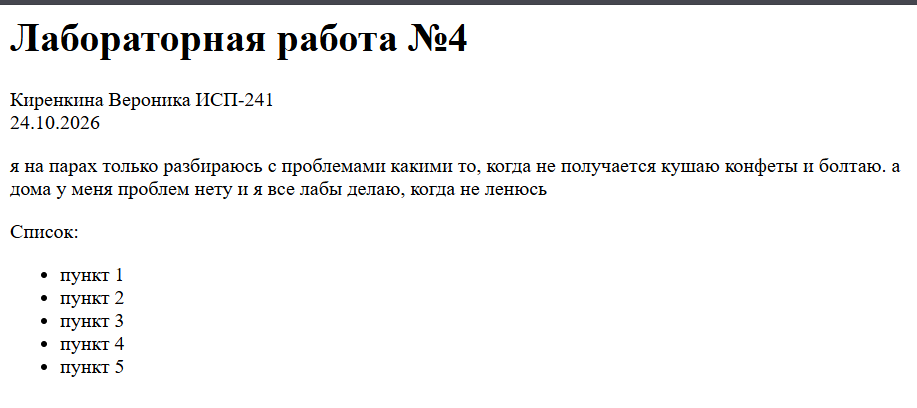

# H1
## H2
### H3
#### H4
##### H5
###### H6

---

**жирный**
*курсив*
~~зачеркнутый~~
`моноширный`

маркированный список:
- пункт 1
- пункт 2

нумерованный список:
1. пункт 1
2. пункт 2

вложенный список:
- пункт 1
    - пункт 1
    - пункт 2

> цитата

```bash
git status
```
| столбец 1 | столбец 2 | столбец 3 |
|-----------|-----------|-----------|
|1|2|3|
|1|2|3|
|1|2|3|



[ссылка на репозиторий на github](https://github.com/oxsjkw/Lab4_ISRPO_kirenkina)
[ссылка на первый заголовок](#h1)

- [x] чекбокс сделано
- [ ] чекбокс не сделано

> [!NOTE]
Пример

$a^2 + b^2 = c^2$

$$
\sum_{i=1}^n i = \frac{n(n+1)}{2}
$$